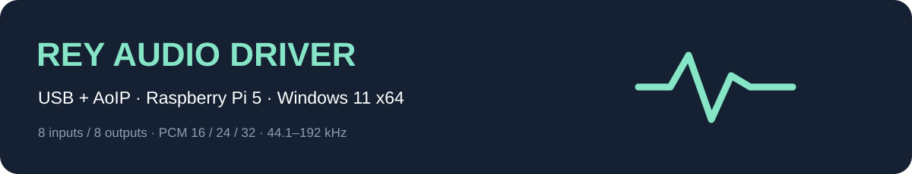
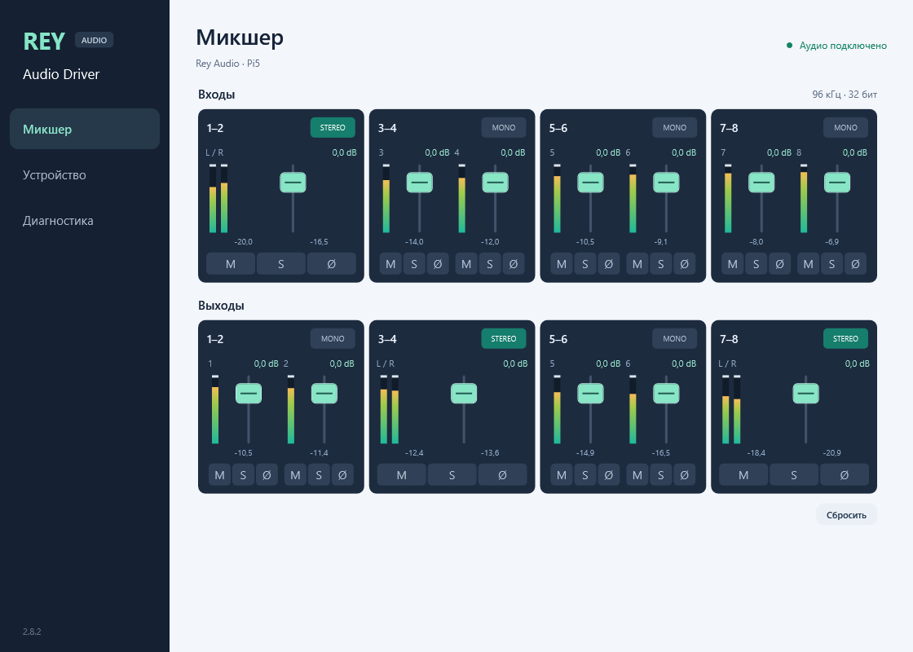
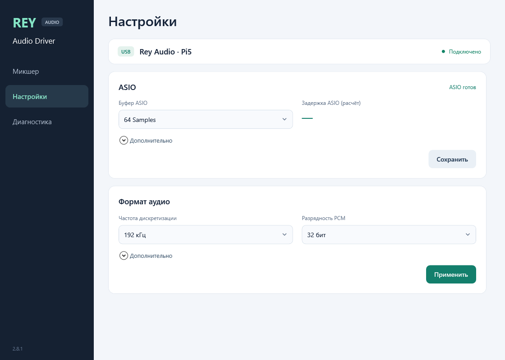
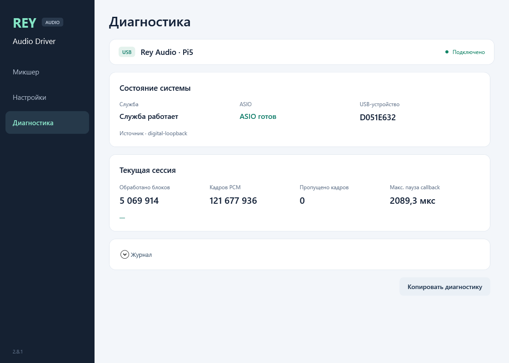

# Rey Audio Driver

[English](README.md) · **Русский**

**USB-аудио, ASIO и микшер для одной Raspberry Pi 5 в Windows x64.**
Восемь входов и восемь выходов, целочисленный PCM16/24/32 и шесть частот
от 44,1 до 192 кГц. Служба подключает плату автоматически и продолжает работать
после закрытия окна микшера.

**В разработке:** [режимы платы AKM](docs/AKM-OPERATING-MODES.ru.md) — два выбора
в ASIO-панели: «Аудиокарта» и «Комбинированный». Без USB автоматически включается
процессор эффектов. Для эффектов предел 96 кГц, нынешний USB-транспорт ограничен
192 кГц. В этой ветке добавлены транспорт AKM USB/JACK, автоматические параметры
для каждой частоты и упрощённая панель. [Проверка 16 октября](docs/USB-LATENCY-2026-10-16.md)
включает настоящий USB-кабель и Pi, но не аналоговый тракт АЦП/ЦАП.

**[Скачать USB-версию 2.8.1 preview 2](https://github.com/danrey-bilo/Rey-Audio-Driver-win/releases/tag/v2.8.1-usb-preview.2)**
· [Установка и Ableton](docs/USB-ASIO.ru.md)
· [Документация](docs/README.ru.md)
· [Транспорт Pi5-AUSB](https://github.com/danrey-bilo/Pi5-AUSB)

> **Исторический цифровой echo-стенд 2.8.1.** Профили 96/192 кГц прошли 175 с без ошибок PCM, RTT p99 —
> около 1,53 мс. Редкие максимумы пока превышают 3 мс. Реальные проверки
> Ableton и границы аппаратной проверки описаны в
> [отчёте 2.8.1](docs/USB-LATENCY-2.8.1.ru.md).

## Микшер

Все восемь входов и восемь выходов видны одновременно. У каждой соседней пары
есть независимый переключатель **MONO / STEREO**. В стереопаре общие уровень,
Mute, Solo и полярность; звук и индикаторы L/R остаются раздельными.
Новые профили начинаются с 0 dB. В панели три страницы — **Микшер**,
**Устройство**, **Диагностика** — и доступ из трея. На снимке тестовые уровни;
проверки установленной службы и USB описаны [отдельно](docs/MIXER.ru.md).

<strong>Настройки USB и диагностика</strong>

## Запуск в Ableton

1. Скачайте из релиза **Rey-Audio-USB-ASIO-2.8.1-preview.2-x64.exe** и запустите.
   Подтвердите UAC: установятся ASIO-драйвер, автоматическая служба и панель/трей.
2. Подключите одну настроенную плату Pi5-AUSB по USB. Откройте **Rey Audio Driver**.
3. В Ableton **Settings → Audio** выберите **Driver Type: ASIO** и
   **Audio Device: Rey Audio USB ASIO**. Включите нужные входы и выходы.
4. Начните с **64 Samples**. В текущей ветке очередь USB и запас отправки
   выбираются автоматически; вручную меняется буфер ASIO.
   См. [руководство по буферам](docs/BUFFER-GUIDE.ru.md).

USB-интерфейс обслуживает Microsoft WinUSB. Установочный INI, собственный
драйвер ядра, тестовый сертификат, Test Mode и изменение загрузки/защиты
не требуются. Перед обновлением полностью закройте DAW: она может удерживать
ASIO DLL. Смена формата и повторное открытие описаны в
[инструкции установки](docs/USB-ASIO.ru.md).

## Возможности

| Возможность | USB preview |
|---|---|
| Устройство | Одна Rey Audio USB; автоматическое обнаружение и постоянный ID |
| Каналы | 8 входов + 8 выходов |
| Форматы | PCM16, упакованный PCM24, целочисленный PCM32 |
| Частоты | 44,1 / 48 / 88,2 / 96 / 176,4 / 192 кГц |
| Транспорт | Pi5-AUSB, USB High-Speed interrupt, асинхронный WinUSB |
| Обработка | Ограниченные PCM-кольца, плавный gain, Mute/Solo/полярность, индикаторы |
| Буферы | Выбор буфера ASIO; очередь и запас USB задаются автоматически по частоте |
| Автозапуск | Служба при загрузке Windows; панель/трей при входе |
| Настройки | Атомарный профиль USB/микшера в реестре; перенос прежних USB-настроек |
| Chrome / Telegram | Системные аудиоустройства Windows — отдельный этап проверки |

## Проверки

| Проверка | Результат 2.8.1 |
|---|---|
| Контракты Windows | **32/32 прошли** |
| Pi5-AUSB, Windows / Pi | **7/7 / 7/7 прошли**; SDK consumer 0.1.1 EXACT — **1/1** |
| PCM16/24/32 × 96/192 кГц | **6/6 прошли**, по пять секунд, блок64/запас3/depth4 |
| Финальный native 192 кГц / блок64 / запас3 / depth4 | **175 с**, без capture drops, render late/missing и overflow |
| Финальный native 96 кГц / блок32 / запас3 / depth4 | **175 с**, те же нулевые счётчики |
| Реальный Ableton, 192/64 и 96/32, запас3/depth4 | **По 175 с, Simulator 50%**, без drops/late/missing/overflow |
| RTT p50 / p95 / p99 / max, 192 кГц | **1,3536 / 1,4298 / 1,5280 / 4,3675 мс** |
| RTT p50 / p95 / p99 / max, 96 кГц | **1,3665 / 1,4227 / 1,5199 / 3,1292 мс** |
| Темп кадров, 192 / 96 кГц | **−0,0706% / −0,0219%**; внутри допуска стенда ±1% |

Это измерения цифровой петли нативного host. Реальные наблюдения Ableton,
включая неуспешные малые буферы, приведены отдельно в
[отчёте](docs/USB-LATENCY-2.8.1.ru.md). Строгий максимум RTT ниже 3 мс пока не достигнут.
ASIO сообщает расчёт буферов **1,5052 / 1,5104 мс** для этих кандидатов;
он не заменяет аналоговый RTT. ADC/DAC не подключался.
[Все исходные результаты](docs/evidence/rey-usb-latency-281-20261003.json).

## Сборка и устройство проекта

Нужны Windows x64, C++17, CMake, .NET Framework 4.8, Pi5-AUSB и отдельно
полученные интерфейсные заголовки Steinberg ASIO. SDK в репозиторий не включён.
[Инструкция сборки](docs/BUILD.ru.md).

| Документ | Содержание |
|---|---|
| [Архитектура](docs/ARCHITECTURE.ru.md) | Владение USB, PCM-кольца и границы модулей |
| [API управления](docs/API.ru.md) | USB-профиль, микшер и диагностика |
| [Микшер](docs/MIXER.ru.md) | Управление каналами, направления и уровни |
| [Описание релиза](docs/USB-PREVIEW2-20261004.ru.md) | Интерфейс, запуск трея и очистка Pi |
| [Отчёт проверки](docs/USB-LATENCY-2.8.1.ru.md) | Hashes, успешные/неуспешные тесты, оставшиеся проверки |
| [Системные устройства Windows](docs/ENDPOINTS.ru.md) | Статус отдельного backend для обычных программ |

Начиная с **2.8.0**, разработка продолжается только для USB и одной платы.
AoIP/LAN и управление несколькими картами выведены из активной сборки;
исходники и отчёты сохранены в [истории Git](https://github.com/danrey-bilo/Rey-Audio-Driver-win/blob/18e6353fa767dcbcde1cef15dabab339848e62d1/archive/aoip/README.md).
Архив прежних исходников удалён из текущего дерева проекта.
Отдельные репозитории AoIP и прежние release assets не изменены.

[Лицензия](LICENSE) · [Внешний ASIO SDK](docs/ASIO-SDK.ru.md)

**[Обновление интерфейса и очистка Pi](docs/USB-PREVIEW2-20261004.ru.md)**
