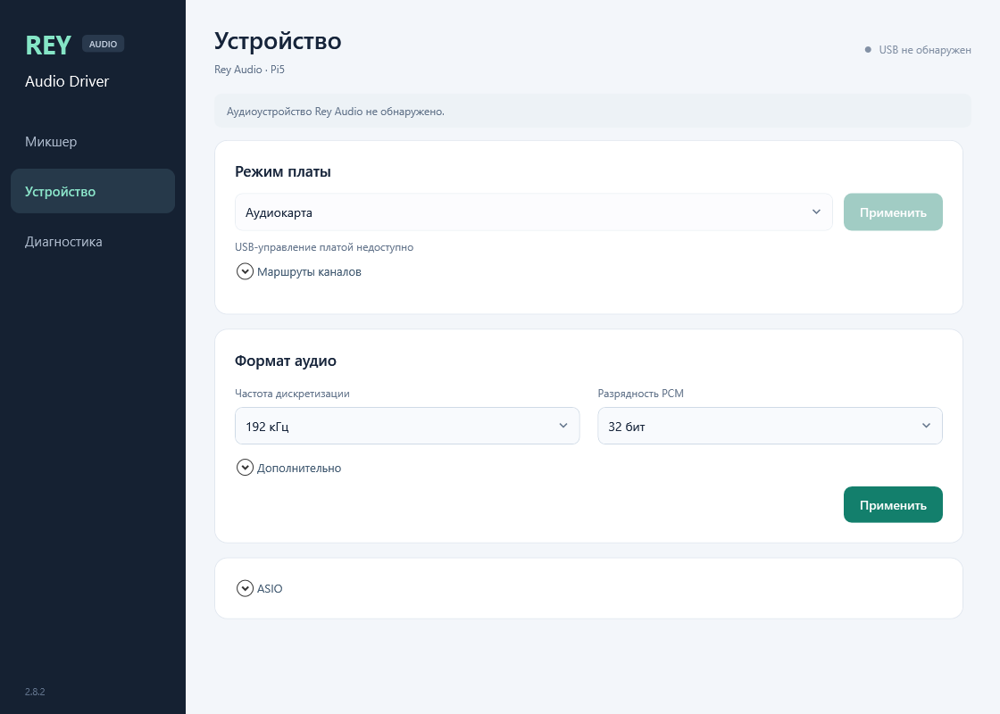

# Микшер одной USB-карты

Главная страница — **Микшер**. Сверху показаны карта и состояние подключения;
ID находится в диагностике. Выбора нескольких карт и переключателя транспорта нет.
Кнопки **Входы** и **Выходы** показывают восемь соответствующих полос.

Канал: уровень −60…+12 dB, Mute, Solo, инверсия полярности, реальный пиковый
PCM-индикатор и счётчик клиппинга. Master регулирует все выходы от −60 до
+6 dB. Входы влияют на запись до передачи в ASIO, выходы и Master — на
воспроизведение после ASIO. Solo оставляет выбранные каналы одного направления.

Регулировки сглаживаются без выделения памяти, не перезапускают USB и не
добавляют очередь. Один профиль/микшер сохраняется в реестре службы. Сброс
возвращает 0 dB и выключает Mute/Solo/полярность. Закрытие панели в трей
не останавливает аудиослужбу или ASIO-host.

Остальные страницы — **Устройство** и **Диагностика**. В «Устройстве» сначала
показаны режим платы и формат аудио; ASIO, маршруты каналов и параметры очереди
раскрываются отдельно. Общая громкость и сброс микшера — в «Дополнительно».
Счётчики аудиопотока и журнал раскрываются в диагностике.

Панель запускается в трее при входе в Windows. Значок остаётся доступным и без
USB или связи со службой; подсказка показывает настоящее состояние. Управление
платой по CDC и USB-аудио имеют разные статусы. Один левый щелчок открывает
панель. Закрытие и сворачивание оставляют значок; «Выход» завершает только
панель. Windows может поместить его под стрелку скрытых значков. При открытом
микшере таймер обновления — 100 мс, в фоне опрос сокращён.
[Системные входы/выходы](ENDPOINTS.ru.md) — отдельный этап.

Обновление от 16 октября 2026 прошло 21 проверку C# и конечный тест настоящих
WPF-компонентов: три страницы при обычном и минимальном размере окна,
раскрытие ASIO, шесть сочетаний состояния USB/службы, закрытие и сворачивание.
Использованы тестовые данные; передача физического USB-аудио этим не доказана.
Панель установлена с проверкой хешей; служба, DLL ASIO и сохранённые настройки
сохранены. Версия файла панели: `2.8.2.2`.

[Результаты проверки интерфейса](evidence/ui-20261016.json)

